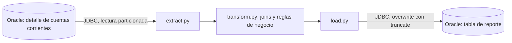

# ETL con PySpark: detalle de cuentas corrientes

Pipeline en Apache Spark (PySpark) que lee el detalle de cuentas corrientes de una base Oracle, aplica reglas de negocio y carga el resultado en una tabla de reporte. Reemplaza un proceso basado en vistas Oracle que tardaba entre 4 y 6 horas.

> Caso de un sistema de administración tributaria. Los nombres de tablas, servidores y credenciales fueron reemplazados por variables de entorno y los datos reales no forman parte de este repositorio.

## Resultado

| | Antes (vistas Oracle) | Después (Spark) |
|---|---|---|
| Tiempo de carga | 4 a 6 horas | ~15 minutos |

<!-- CONFIRMAR antes de publicar: si los 15 minutos incluyen la escritura final en Oracle o solo la transformación, y sobre cuántas filas se hizo la comparación. -->

La mejora se midió comparando tiempos de ejecución en una prueba de concepto contra el proceso existente. La tabla de origen tiene alrededor de 110 millones de filas.

## Arquitectura



## Estructura del proyecto

```
.
├── main.py            # punto de entrada: arma la sesión de Spark y orquesta el flujo
├── config.py          # lee la configuración desde variables de entorno
├── extract.py         # lectura JDBC desde Oracle
├── transform.py       # transformaciones y reglas de negocio
├── load.py            # escritura JDBC en Oracle
├── .env.example       # plantilla de configuración (sin valores reales)
└── requirements.txt
```

## Qué hace la transformación

1. Para cada combinación de contribuyente, año y cuota, calcula la **última fecha de movimiento** de dos subconceptos (uno mensual y uno anual).
2. Une esos resultados al detalle original con `left join`.
3. **Ajusta la fecha de movimiento** de ciertos subconceptos según la última fecha mensual o anual registrada.
4. Clasifica cada movimiento como **corriente o no corriente** comparándolo con la fecha de vencimiento: las obligaciones anuales se comparan por año y el resto por año y mes. A partir de esa clasificación calcula débitos y créditos corrientes.
5. Normaliza tipos (identificadores a `long`) y redondea los importes a 2 decimales.

## Decisiones técnicas

- **Código modular.** Cada etapa (lectura, transformación, escritura) está en su propio módulo, lo que permite probar la lógica de negocio sin conectarse a la base.
- **Configuración por variables de entorno.** Ninguna credencial, dirección de servidor ni nombre de tabla está en el código. Hay un `.env.example` como plantilla y el `.env` real está excluido por `.gitignore`.
- **Lectura JDBC paralela por año.** Cuando se procesa más de un año, la lectura se reparte en particiones por la columna `ANIO`. Con un solo año no hay forma de paralelizarla por esa columna, y el código lo detecta y lo informa en el log.
- **Regla corriente / no corriente en una sola función.** La condición se usaba en tres columnas de salida y se extrajo a `_es_corriente`, para mantener una única definición.
- **Escritura con `overwrite` y `truncate`.** Se vacía la tabla destino sin eliminarla ni recrearla, de modo que se conservan su estructura y sus permisos.
- **Caché opcional.** El DataFrame de origen alimenta tres ramas del plan; se puede cachear con `CACHE_SOURCE=true` según la memoria disponible.

## Cómo ejecutarlo

Requisitos: Python 3.9 o superior, Java, un cluster Spark (o modo local) y el driver JDBC de Oracle disponible para Spark.

```bash
pip install -r requirements.txt
cp .env.example .env      # completar con los valores del entorno
python main.py
```

### Variables de entorno

| Variable | Obligatoria | Descripción | Valor por defecto |
|---|---|---|---|
| `SPARK_MASTER` | Sí | URL del master de Spark | |
| `DB_JDBC_URL` | Sí | URL JDBC de Oracle | |
| `DB_USER` | Sí | Usuario de la base | |
| `DB_PASSWORD` | Sí | Contraseña de la base | |
| `SOURCE_TABLE` | Sí | Tabla de origen | |
| `TARGET_TABLE` | Sí | Tabla de destino | |
| `ANIO_DESDE` / `ANIO_HASTA` | No | Rango de años a procesar | `2017` / `2017` |
| `READ_PARTITIONS` | No | Particiones máximas de la lectura | `10` |
| `JDBC_FETCH_SIZE` | No | Filas por viaje en la lectura | `20000` |
| `JDBC_WRITE_BATCH_SIZE` | No | Filas por lote en la escritura | `50000` |
| `CACHE_SOURCE` | No | Cachear el DataFrame de origen | `false` |
| `SPARK_DRIVER_MEMORY` | No | Memoria del driver | `10g` |
| `SPARK_EXECUTOR_MEMORY` | No | Memoria de cada executor | `3g` |
| `SPARK_EXECUTOR_CORES` | No | Núcleos por executor | `6` |
| `SPARK_SHUFFLE_PARTITIONS` | No | Particiones de shuffle | `48` |

## Limitaciones y próximos pasos

- Agregar **tests con Pytest** sobre `transform.py`, usando DataFrames pequeños de ejemplo.
- Pasar de la recarga completa (`overwrite`) a una **carga incremental** por rango de fechas.
- Sumar **validaciones de calidad** antes de escribir (conteo de filas, claves nulas).
- Orquestar la ejecución con **Apache Airflow**.

## Stack

Python · Apache Spark / PySpark · Oracle (JDBC) · variables de entorno